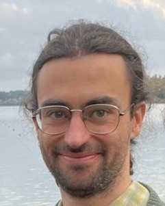

# Alexi Quintana Mathé

I am a sociologist by training and a quantitative social scientist specialized in social networks. I hold a PhD in Network Science from Northeastern University (2026), where I worked in [David Lazer's lab](https://www.lazerlab.net/), and bachelor's degrees in Sociology (Universitat de Barcelona) and Mathematics (Universitat Politècnica de Catalunya). I am currently a visiting researcher at the Lazer Lab. During my PhD I also collaborated with the ERC project PATCHWORK at the [COALESCE Lab](https://coalesce-lab.com/) (Universitat Autònoma de Barcelona) and was a visiting researcher at University College Dublin. I study how the environments in which people interact, online and offline, shape their social relationships, and with them social cohesion and integration. My research combines the two main large-scale sources of network data: surveys and digital trace data.

**Research interests:** personal networks, homophily, social cohesion, computational social science, survey research, online information ecosystems.

<a href="/files/CV_Quintana-Mathe.pdf">CV (PDF)</a> ·
<a href="https://scholar.google.com/citations?user=CfPeWzUAAAAJ&amp;hl=en">Google Scholar</a> ·
<a href="https://orcid.org/0000-0002-7315-9480">ORCID</a> ·
<a href="https://www.lazerlab.net/people/alexi-quintana-mathe">Lazer Lab profile</a> ·
<a href="https://coalesce-lab.com/en/team/7/alexi-quintana-mathe">COALESCE Lab profile</a> ·
<a href="mailto:quintana.alexi@gmail.com">quintana.alexi@gmail.com</a>

See my [research](/research/) for the projects I have worked on, and my [publications](/publications/) for the full list of papers.
